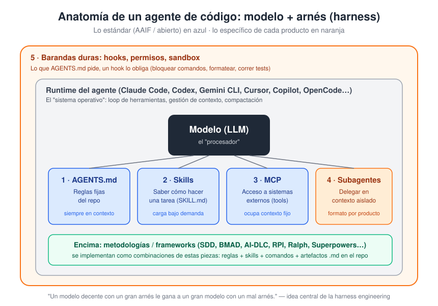
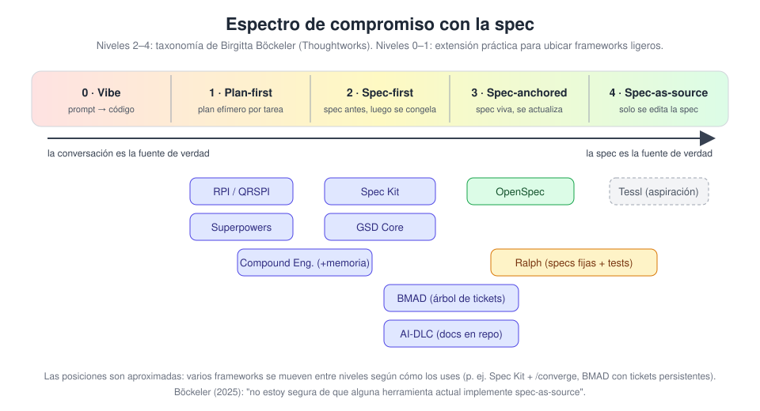
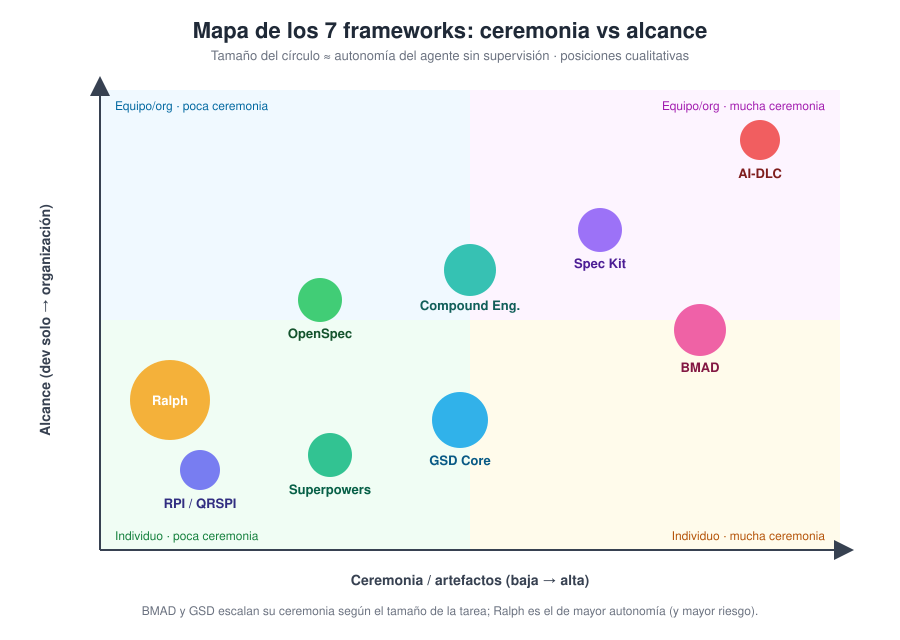

# 01 · Brief — Frameworks de desarrollo de software con IA agéntica (2026)

> **Propósito de este documento:** servir como contexto base para un proyecto nuevo de exploración y comparación de frameworks/metodologías de desarrollo con agentes de IA. Está pensado para ser leído tanto por humanos como por un agente de código (puede referenciarse desde `AGENTS.md`).
>
> **Fecha de corte:** noviembre 2026. El ecosistema cambia rápido; verificar versiones antes de adoptar.
>
> **Alcance:** (1) la base común de *harness engineering* y los estándares abiertos, (2) los niveles de Spec-Driven Development (SDD), (3) los 9 frameworks: Spec Kit, OpenSpec, BMAD, AI-DLC, RPI/QRSPI, Ralph loop y los arneses de skills (Superpowers, Compound Engineering, GSD Core).

---

## Índice

1. [Parte 1 — Base común: harness engineering y estándares abiertos](#parte-1--base-común-harness-engineering-y-estándares-abiertos)
   - 1.1 [Modelo mental: modelo + arnés](#11-modelo-mental-modelo--arnés)
   - 1.2 [Agentic AI Foundation (AAIF)](#12-agentic-ai-foundation-aaif)
   - 1.3 [Las 5 piezas del arnés](#13-las-5-piezas-del-arnés)
   - 1.4 [Disciplinas: prompt, context, harness y loop engineering](#14-disciplinas-prompt-context-harness-y-loop-engineering)
   - 1.5 [Estructura de repo recomendada](#15-estructura-de-repo-recomendada)
   - 1.6 [Términos clave](#16-términos-clave) · glosario completo en [00 · Glosario](00-glosario.md)
2. [Parte 2 — Spec-Driven Development y sus niveles](#parte-2--spec-driven-development-y-sus-niveles)
3. [Parte 3 — Los 9 frameworks](#parte-3--los-9-frameworks)
   - 3.8 [Tabla comparativa](#38-tabla-comparativa)
   - 3.9 [Chuleta: qué framework para qué proyecto](#39-chuleta-qué-framework-para-qué-proyecto)
4. [Fuentes y lecturas](#fuentes-y-lecturas)

---

## Parte 1 — Base común: harness engineering y estándares abiertos

### 1.1 Modelo mental: modelo + arnés

Un **agente de código** no es solo el modelo de lenguaje. Es el **modelo + todo lo que se construye a su alrededor**: instrucciones, herramientas, memoria, permisos, bucles de verificación. Ese andamiaje se llama **arnés** (*harness*).



Analogía útil (Anthropic, charla *"Don't Build Agents, Build Skills Instead"*):

| Computación clásica | Agente de código |
|---|---|
| Procesador | Modelo (LLM) |
| Sistema operativo | Runtime del agente (Claude Code, Codex, Gemini CLI, Cursor…) |
| Aplicaciones | Skills |
| Drivers / periféricos | Servidores MCP |
| Configuración del sistema | AGENTS.md, settings, hooks |

**Idea central de la harness engineering:** *un modelo decente con un gran arnés le gana a un gran modelo con un mal arnés*. Cuando el agente se equivoca, en vez de culpar al modelo y "esperar la próxima versión", se ajusta el arnés (una regla, una skill, un hook, un test) para que ese error no vuelva a ocurrir. El arnés se trata como un **artefacto de ingeniería versionado**, que mejora cada vez que el agente falla.

### 1.2 Agentic AI Foundation (AAIF)

- **Qué es:** un fondo dirigido (*directed fund*) dentro de la **Linux Foundation**, creado el **9 de diciembre de 2025**, para dar gobernanza neutral a estándares abiertos de IA agéntica, de modo que ninguna empresa controle su dirección.
- **Fundadores:** Anthropic, OpenAI y Block, con apoyo de Google, Microsoft, AWS, Bloomberg y Cloudflare.
- **Proyectos semilla:**
  - **MCP** (Model Context Protocol), donado por Anthropic → cómo un agente se conecta a herramientas y datos.
  - **AGENTS.md**, donado por OpenAI → cómo un repo le da instrucciones a un agente.
  - **goose**, donado por Block → un framework/agente open source de referencia.
- **Por qué importa:** evita que el ecosistema se fragmente en formatos incompatibles. Un repo bien preparado con estos estándares funciona con casi cualquier agente.
- **Agent Skills** (`SKILL.md`) es otro estándar abierto (publicado por Anthropic el 18-dic-2025 en agentskills.io). No nació dentro de la AAIF, pero sigue el mismo camino de apertura y ya lo adoptan decenas de productos.

### 1.3 Las 5 piezas del arnés

| # | Pieza | Pregunta que responde | ¿Estándar abierto? | Siempre en contexto |
|---|---|---|---|---|
| 1 | **AGENTS.md** | ¿Qué reglas fijas tiene este repo? | Sí (AAIF) | Sí |
| 2 | **Skills** | ¿Cómo se hace esta tarea concreta? | Sí (agentskills.io) | Solo nombre + descripción |
| 3 | **MCP** | ¿Con qué sistemas externos puedo hablar? | Sí (AAIF) | Definiciones de tools, sí |
| 4 | **Subagentes** | ¿A quién delego para no ensuciar mi contexto? | No (cada producto) | No |
| 5 | **Hooks / permisos / sandbox** | ¿Qué está prohibido u obligatorio pase lo que pase? | No (cada producto) | No aplica (son código) |

#### 1.3.1 AGENTS.md — las reglas del repo

- **Qué es:** un archivo Markdown en la raíz del repo, "un README para agentes". Sin campos obligatorios. Lo usan más de 60.000 proyectos open source.
- **Para qué:** separar la documentación para humanos (README) de las instrucciones operativas para agentes: comandos exactos, convenciones, cosas prohibidas.
- **Secciones recomendadas:** resumen del proyecto · comandos de build/test/lint · estilo de código · instrucciones de testing · seguridad · reglas de commits/PR.
- **Precedencia:**
  1. El prompt explícito del usuario en el chat gana sobre todo.
  2. El `AGENTS.md` **más cercano** al archivo editado gana (monorepos: uno por subproyecto).
  3. El `AGENTS.md` raíz.
- **Compatibilidad:** Codex, Jules, Gemini CLI, Cursor, Copilot, Windsurf, Junie, Zed, Aider, goose, opencode, Amp, Devin, entre otros. **Claude Code** lee `CLAUDE.md`: se resuelve con un symlink `CLAUDE.md → AGENTS.md` o escribiendo `@AGENTS.md` dentro de `CLAUDE.md`.
- **Buenas prácticas:**
  - Corto y operativo. Si crece, mover el detalle a skills o a `docs/`.
  - Comandos copiables, no descripciones vagas ("corre `pnpm test`", no "asegúrate de que funcione").
  - Cada error repetido del agente → una regla nueva. Así crece el arnés.

```markdown
# AGENTS.md
## Comandos
- Instalar: `pnpm install` · Test: `pnpm test` · Lint: `pnpm lint`
## Reglas
- TypeScript estricto, sin `any`
- Nunca editar `/generated`
- Antes de commit: lint + tests en verde
## Seguridad
- No leer ni escribir `.env*`
```

#### 1.3.2 Skills — conocimiento procedimental bajo demanda

- **Qué es:** una carpeta con un `SKILL.md` (frontmatter YAML + instrucciones en Markdown) y opcionalmente `scripts/`, `references/`, `assets/`.
- **Para qué:** empaquetar *cómo se hace algo* (desplegar, migrar, revisar seguridad, generar un release) de forma reutilizable y portable entre agentes.
- **Frontmatter obligatorio:** `name` (minúsculas, 1–64 chars, igual al nombre de la carpeta) y `description` (1–1024 chars). La `description` es lo que el agente lee para decidir si activarla, así que es lo más importante de afinar.
- **Divulgación progresiva** (*progressive disclosure*), en tres niveles:
  1. Al inicio, el agente solo ve `name` + `description` (~100 tokens por skill).
  2. Si la tarea encaja, carga el cuerpo del `SKILL.md` (mantenerlo < 500 líneas).
  3. Si hace falta, abre `references/` o ejecuta `scripts/`.
- **Cómo crear una:** hacer la tarea una vez con el agente → pedirle que la convierta en skill → afinar la `description` hasta que se active sola → validar con `skills-ref validate ./mi-skill`.
- **Skills vs MCP:** MCP da **acceso** (conectores); la skill enseña **cómo** usarlo. A menudo una skill con un script reemplaza un servidor MCP y gasta menos contexto.

```markdown
---
name: release-ios
description: Compila y sube la app a TestFlight. Úsala cuando pidan build iOS, release o TestFlight.
---
## Pasos
1. Corre `scripts/bump-version.sh`
2. `cd ios && pod install`
3. Si falla el signing, lee `references/signing.md`
```

#### 1.3.3 MCP — conexión con el mundo exterior

- **Qué es:** un protocolo cliente-servidor. El agente (cliente) se conecta a **servidores MCP** que exponen:
  - **Tools:** acciones invocables (crear issue, consultar BD, abrir navegador).
  - **Resources:** datos legibles (archivos, registros).
  - **Prompts:** plantillas reutilizables.
- **Transportes:** `stdio` (proceso local) o HTTP *streamable* (remoto, admite OAuth).
- **Configuración por producto:**
  - Claude Code: `.mcp.json` en la raíz (alcance proyecto, versionable) o `~/.claude.json`.
  - Codex: `[mcp_servers.<nombre>]` en `~/.codex/config.toml` o `.codex/config.toml` del proyecto.
  - VS Code / Copilot: `.mcp.json` (formato portable `mcpServers`) o `.vscode/mcp.json`.
- **Precauciones:** cada servidor añade definiciones de herramientas al contexto, así que conviene instalar pocos y por proyecto. Los secretos van en variables de entorno, nunca en archivos versionados. Un MCP de terceros es código de terceros: hay que revisarlo como una dependencia.

#### 1.3.4 Subagentes — delegación con contexto aislado

- **Qué es:** un agente hijo que arranca con su **propia ventana de contexto**, hace una tarea (investigar, revisar, buscar) y devuelve un resumen. El contexto del agente principal queda limpio.
- **Uso correcto:** **control de contexto**, no juego de roles. El valor está en aislar el ruido (búsquedas, logs largos), no en "personajes".
- **No hay estándar:** Claude Code usa `.claude/agents/*.md` (YAML + Markdown; el cuerpo es el system prompt), Codex `.codex/agents/*.toml`, Cursor `.cursor/agents/*.md`, VS Code *custom agents* con `tools` y `handoffs`.
- **Patrón portable:** poner la lógica en una **skill** (estándar) y hacer cada subagente un envoltorio delgado de pocas líneas por producto. Limitar las `tools` a lectura cuando solo revisa.

#### 1.3.5 Hooks, permisos y sandbox — las barandas duras

- **Hooks:** scripts que el runtime ejecuta en eventos (antes o después de usar una herramienta, al terminar la sesión, al enviar un prompt). Ejemplos: bloquear `rm -rf`, formatear tras cada edición, correr tests antes de dar algo por terminado.
- **Permisos:** listas de herramientas o comandos permitidos o denegados, y modos de aprobación (preguntar siempre, auto-aprobar lecturas, etc.).
- **Sandbox:** contenedor o VM sin credenciales de producción donde el agente puede actuar sin riesgo. **Obligatorio** para loops autónomos (Ralph).
- **La regla mental:** *AGENTS.md **pide**; un hook **obliga***. Lo crítico (seguridad, datos) no puede depender de que el modelo "se acuerde".

### 1.4 Disciplinas: prompt, context, harness y loop engineering

Son capas que se apilan; cada una contiene a la anterior.

| Disciplina | Unidad de trabajo | Pregunta clave | Ejemplo |
|---|---|---|---|
| **Prompt engineering** | Un mensaje | ¿Cómo lo pido? | Redactar instrucciones claras con ejemplos |
| **Context engineering** | La ventana de contexto | ¿Qué tokens tiene delante el modelo ahora? | Compactar, usar subagentes, mantener uso < 40–60 % |
| **Harness engineering** | El sistema alrededor del modelo | ¿Qué reglas, herramientas y barandas lo rodean? | AGENTS.md + skills + hooks + tests |
| **Loop engineering** | El ciclo externo | ¿Quién le da los prompts al agente y cuándo para? | Ralph loop, pipelines análisis→plan→ejecución |

Conceptos de contexto que aparecen en todos los frameworks:

- **Ventana de contexto** (*context window*): memoria de trabajo del modelo en una sesión, medida en tokens.
- **Degradación del contexto** (*context rot*) y **"zona tonta"** (*dumb zone*): la calidad cae a medida que la ventana se llena. HumanLayer la observa a partir de ~40 % de uso.
- **Compactación intencional** (*intentional compaction*): destilar el estado en un archivo (`progress.md`, `STATE.md`, `plan.md`) y reiniciar con contexto limpio, en vez de dejar que el agente resuma solo.
- **Presupuesto de instrucciones** (*instruction budget*): los modelos frontera siguen de forma fiable un número limitado de instrucciones (~150–200, sumando las del sistema y las herramientas). Prompts por etapa cortos (< 40 instrucciones) rinden más.
- **Un chat nuevo por tarea:** patrón común a BMAD, GSD, RPI y Ralph. El único estado compartido son los archivos del repo.

### 1.5 Estructura de repo recomendada

```
repo/
├── AGENTS.md                 # fuente única de reglas
├── CLAUDE.md -> AGENTS.md    # compatibilidad Claude Code
├── .mcp.json                 # MCP del proyecto (sin secretos)
├── skills/                   # skills portables (estándar)
├── .claude/skills -> ../skills
├── .claude/agents/           # envoltorios delgados de subagentes
├── .codex/agents/
├── docs/
│   ├── specs/                # SDD (Spec Kit / OpenSpec)
│   ├── adr/                  # decisiones de arquitectura
│   └── agent/<ticket>/       # research.md, design.md, outline.md, progress.md
└── scripts/ci.sh             # verificación ejecutable (backpressure)
```

### 1.6 Términos clave

El vocabulario completo, con definiciones, mini-ejemplos y la lista de documentos donde aparece cada término, está en **[00 · Glosario](00-glosario.md)**. Los términos específicos de un framework (constitución, bolt, sharding…) se definen en la sección 5 de su documento. Estos son los 10 imprescindibles para leer este brief:

| Término | Inglés | En una línea |
|---|---|---|
| [Arnés](00-glosario.md#agentes-y-arnes) | Harness | Todo lo que rodea al modelo: instrucciones, herramientas, memoria, permisos y verificación. |
| [Ingeniería de contexto](00-glosario.md#contexto-y-prompts) | Context engineering | Decidir qué tokens tiene delante el modelo en cada momento. |
| [Zona tonta](00-glosario.md#contexto-y-prompts) | Dumb zone | Uso de contexto (≈ > 40 %, según HumanLayer) donde cae la calidad. |
| [AGENTS.md](00-glosario.md#estandares-y-protocolos) | AGENTS.md | "README para agentes": comandos, convenciones y prohibiciones del repo. |
| [Skill](00-glosario.md#estandares-y-protocolos) | Skill | Carpeta con `SKILL.md` que enseña un procedimiento y se carga bajo demanda. |
| [MCP](00-glosario.md#estandares-y-protocolos) | Model Context Protocol | Protocolo estándar para conectar agentes con herramientas y datos. |
| [Baranda blanda / dura](00-glosario.md#barandas-y-seguridad) | Soft / hard guardrail | Regla en texto que el agente *debería* seguir / restricción que el sistema impone (hook, permiso). |
| [Contrapresión](00-glosario.md#barandas-y-seguridad) | Backpressure | Tests, tipos y lint que rechazan trabajo incorrecto. |
| [Sandbox](00-glosario.md#barandas-y-seguridad) | Sandbox | Entorno aislado sin credenciales reales; obligatorio para loops autónomos. |
| [Spec / SDD](00-glosario.md#spec-driven-development) | Spec / Spec-Driven Development | Documento del *qué*, aprobado antes del código, que guía al agente. |

---

## Parte 2 — Spec-Driven Development y sus niveles

### 2.1 Qué es SDD

**Spec-Driven Development** = escribir una especificación *antes* del código y usarla como guía principal del agente. Tesis: *si la IA escribe el código, la spec es el artefacto que importa*. El flujo típico pasa de `prompt → código` a `spec → plan → tareas → código → verificación`.

Por qué surgió: los agentes producen código plausible pero sutilmente incorrecto cuando la intención solo vive en un chat que se pierde. La spec **fija la intención**, hace visibles las ambigüedades antes de programar y deja trazabilidad.

### 2.2 Los niveles

Birgitta Böckeler (Thoughtworks, martinfowler.com) define **tres niveles** de SDD. Para ubicar los frameworks ligeros, este brief añade dos niveles previos (0 y 1); **son una extensión propia, no parte de su taxonomía**.



| Nivel | Nombre | Qué significa | Fuente de verdad | Qué pasa con la spec después de implementar |
|---|---|---|---|---|
| 0 | **Vibe coding** | Prompt directo a código | La conversación | No existe |
| 1 | **Plan-first** (efímero) | Plan o diseño escrito por tarea; se descarta al terminar | El plan, mientras dura la tarea | Se archiva o se borra |
| 2 | **Spec-first** | Spec completa antes de codificar; guía la implementación | La spec, hasta el merge | Queda congelada; nadie la mantiene |
| 3 | **Spec-anchored** | Spec persistente del sistema; cada cambio la actualiza | La spec viva + el código | Se fusiona en la spec viva (deltas) |
| 4 | **Spec-as-source** | Solo se edita la spec; el código se regenera | La spec | El código es "salida de compilación" |

#### Nivel 0 — Vibe coding
- ✅ Velocidad máxima, cero ceremonia, ideal para explorar.
- ❌ No reproducible; la intención se pierde; deuda técnica rápida; difícil de revisar.
- 🎯 Prototipos desechables, spikes, scripts de un solo uso, aprender una API.

#### Nivel 1 — Plan-first (efímero)
- ✅ Alinea humano y agente antes de codificar; artefactos cortos que sí se revisan; poco costo.
- ❌ No queda documentación del sistema; cada tarea re-investiga desde cero; depende del criterio del dev.
- 🎯 Bugs difíciles, refactors, brownfield grande, devs senior. *(RPI/QRSPI, Superpowers, Compound Engineering)*

#### Nivel 2 — Spec-first
- ✅ Requisitos explícitos y trazables; las ambigüedades salen antes; buena base para revisión y auditoría.
- ❌ Mucho Markdown (a veces más pesado de revisar que el código); la spec se desactualiza tras el merge; riesgo de "cascada disfrazada".
- 🎯 Features nuevos medianos/grandes, equipos que necesitan acuerdos, contextos regulados. *(Spec Kit, GSD Core, BMAD, AI-DLC)*

#### Nivel 3 — Spec-anchored
- ✅ La spec sirve como documentación viva del sistema para humanos y agentes; el historial de cambios queda como registro de decisiones; ideal para evolucionar sistemas.
- ❌ Mantener la spec al día exige disciplina; se acumulan archivos (*documentation sprawl*); conflictos si varios cambios tocan las mismas requirements.
- 🎯 Productos en producción que evolucionan por muchos cambios pequeños/medianos; equipos que quieren onboarding vía spec. *(OpenSpec)*

#### Nivel 4 — Spec-as-source
- ✅ Una sola fuente de verdad; el código se puede regenerar (nuevo stack, nuevo modelo); máxima trazabilidad.
- ❌ El no-determinismo de los LLM hace que regenerar no sea estable; combina la rigidez del *model-driven development* con la imprevisibilidad del modelo; *lock-in* con herramientas comerciales. Böckeler: no está segura de que alguna herramienta actual lo logre de verdad.
- 🎯 Aspiracional. Casos acotados: generadores, contratos (OpenAPI → cliente), dominios muy formalizables. *(Tessl como aspiración; Ralph en greenfield se acerca en espíritu: specs fijas + tests, el código es reemplazable)*

### 2.3 SDD en general: ventajas, desventajas y críticas

**Ventajas**
- La intención deja de vivir en un chat volátil.
- Las specs viajan entre agentes y modelos (portabilidad).
- Separa el *qué/por qué* (spec) del *cómo* (plan), lo que reduce que el agente invente requisitos.
- Mejora la revisión: es más barato corregir una línea de spec que cien de código.

**Desventajas y críticas**
- **"No reduce el overhead, lo desplaza":** se pasa tiempo manteniendo documentación en vez de evolucionar el sistema.
- **Waterfall Strikes Back** (Marmelab): riesgo de enterrar la agilidad bajo capas de Markdown.
- **Sincronía:** el mismo problema histórico de los docs y los README; la spec diverge del código.
- **Habilidad requerida:** los ingenieros con buen criterio de arquitectura le sacan mucho más; si no sabes evaluar un plan, el plan no te protege.

**Regla práctica:** *escala la ceremonia al riesgo*. Un typo no necesita spec. Un feature que toca pagos sí.

---

## Parte 3 — Los 9 frameworks



### 3.1 Spec Kit (GitHub)

- **Qué es:** kit open source (MIT) de GitHub para SDD con cualquier agente. CLI `specify` + plantillas + slash commands. **v1.0.0** el 21-ago-2026; ~30 integraciones de agentes y ~90 extensiones.
- **Nivel SDD:** **2 · Spec-first** por feature. `/speckit-converge` compara código vs spec y la acerca a *anchored dentro del feature*, pero no mantiene una spec global del sistema.
- **Flujo:** `constitution → specify → clarify → plan → checklist → tasks → analyze → implement → converge` (ruta corta: `specify → plan → tasks → implement → converge`).
- **Artefactos:** [constitución](02-spec-kit.md#5-conceptos-y-glosario-propio), `spec.md`, `plan.md`, `tasks.md`, `checklists/`.
- **Extensibilidad:** presets (cambian comportamiento), extensiones (añaden capacidades: `bug`, `assess`, TDD, Figma…), bundles, workflows.
- ✅ **Ventajas:** realmente agnóstico; trazabilidad requisito → código; `clarify`/`analyze` sacan ambigüedades a tiempo; constitución por capas para empresas; gran ecosistema.
- ❌ **Desventajas:** Markdown verboso y repetitivo; la spec se desactualiza; mucha ceremonia para cambios pequeños; API todavía cambiante tras la 1.0.
- 🎯 **Brilla en:** features nuevos medianos/grandes, equipos de 3+, entornos regulados, organizaciones que usan varios agentes.

### 3.2 OpenSpec (Fission AI)

- **Qué es:** framework SDD ligero (MIT), con ~73k estrellas y 30+ agentes. Thoughtworks Radar: **Trial** (nov-2026).
- **Nivel SDD:** **3 · Spec-anchored**. Es el único de la lista con spec viva del sistema.
- **Cómo funciona:** `openspec/specs/` = verdad actual; cada cambio vive en `openspec/changes/<nombre>/` con `proposal.md`, `design.md`, `tasks.md` y **[delta specs](00-glosario.md#spec-driven-development)** (`ADDED / MODIFIED / REMOVED / RENAMED`). Al archivar, los deltas se fusionan en la spec principal.
- **Flujo:** `/opsx:explore` → `/opsx:propose` → revisar → `/opsx:apply` → `/opsx:archive` (perfil extendido: `new`, `continue`, `ff`, `verify`, `onboard`…).
- ✅ **Ventajas:** el mejor para brownfield (describes el diff, no el destino); más predecible que el prompting suelto; poca ceremonia; historial de cambios = registro de decisiones; cambios en paralelo si tocan requirements distintas.
- ❌ **Desventajas:** dispersión de Markdown; mantener la spec viva exige disciplina; sin capa de producto ni TDD; multi-repo (Stores) en beta.
- 🎯 **Brilla en:** apps en producción que evolucionan, devs solos y equipos pequeños, mantenimiento, documentación viva.

### 3.3 BMAD Method

- **Qué es:** *Breakthrough Method of Agile AI-Driven Development*. Simula un equipo ágil con [personas-agente](04-bmad-method.md#5-conceptos-y-glosario-propio): Mary (analista), John (PM), Sofia (PO), Sally (UX), Winston (arquitecto), Amelia (dev). **v6.12 estable**, **V7 en preview** (todo construido sobre skills).
- **Nivel SDD:** **2 · Spec-first** con tendencia a *anchored* en la jerarquía de tickets (Initiative → Epic → Story con requirements de ID estable), sin fusión automática en una spec de sistema.
- **Ciclo (V7):** Clarify → Plan → Build & verify → Learn & adjust. Se entra donde corresponda; la profundidad escala: trivial · una sesión · tamaño épica · tamaño proyecto.
- **Patrón estrella:** **un chat nuevo por historia**; el archivo de la historia es el paquete completo de traspaso ([*sharding*](04-bmad-method.md#5-conceptos-y-glosario-propio)).
- **Módulos:** Method, Builder, Creative Intelligence Suite, Test Architect, BMad Loop, Game Dev Studio.
- ✅ **Ventajas:** único con capa de producto completa (brief, PRD, UX, arquitectura); ceremonia escalable; buen manejo del contexto en proyectos grandes; personalizable.
- ❌ **Desventajas:** curva de aprendizaje alta; muchos tokens; exagerado para tareas simples; artefactos muy largos; API inestable durante la transición v6 → V7.
- 🎯 **Brilla en:** productos nuevos que necesitan visión, PRD y arquitectura (MVP serio, startup); dev que hace de PM y necesita disciplina de producto.

### 3.4 AI-DLC (AWS)

- **Qué es:** metodología organizacional de AWS (Raja SP, jul-2025) que pone a la IA en el centro del ciclo con los humanos a cargo de las decisiones críticas. Arnés open source `awslabs/aidlc-workflows` (MIT-0; v2 con CLI `aidlc` para Claude Code, Codex, Cursor, Copilot, Kiro, opencode).
- **Nivel SDD:** **2 · Spec-first** a nivel equipo: requisitos, diseño y planes persistidos en el repo entre fases; no define fusión de deltas en una spec viva.
- **Fases:** **Inception** (intent → requisitos, historias, unidades; [*Mob Elaboration*](05-ai-dlc.md#5-conceptos-y-glosario-propio)) → **Construction** (arquitectura, dominio, código, tests; [*Mob Construction*](05-ai-dlc.md#5-conceptos-y-glosario-propio)) → **Operations** (IaC, despliegue).
- **Vocabulario:** [*bolts*](05-ai-dlc.md#5-conceptos-y-glosario-propio) (ciclos de horas/días) en lugar de sprints, [*Units of Work*](05-ai-dlc.md#5-conceptos-y-glosario-propio) en lugar de épicas.
- ✅ **Ventajas:** único pensado para equipos grandes y organizaciones; humano en el centro; cubre Operations; estándares de la organización aplicados por la IA.
- ❌ **Desventajas:** requiere cambio cultural y formación de PM/QA/Ops; los rituales mob chocan con equipos remotos o asíncronos; mide velocidad, no resultado de mercado (sin Sprint Review ni retro explícitas, según Scrum.org); riesgo de que los juniors no aprendan; sesgo de marketing hacia AWS.
- 🎯 **Brilla en:** empresas medianas/grandes en transformación, equipos multidisciplinarios síncronos, programas con patrocinio del liderazgo.

### 3.5 Research → Plan → Implement (HumanLayer) / QRSPI

- **Qué es:** disciplina de *context engineering* de Dex Horthy (HumanLayer, autor de *12-Factor Agents*). No se instala: son prompts y artefactos. En 2026 evolucionó a **QRSPI / "CRISPY"**: Questions → Research → Design → Structure (outline) → Plan → Implement → PR.
- **Nivel SDD:** **1 · Plan-first** (artefactos por ticket: `research.md`, `design.md`, `outline.md`, `plan.md`), sin spec persistente del sistema.
- **Principios:** mantener el contexto < 40–60 %; subagentes para buscar y resumir; [*research ciego*](06-rpi-qrspi.md#5-conceptos-y-glosario-propio) (sin conocer el objetivo, para evitar sesgo); *design discussion* de ~200 líneas; outline de ~2 páginas en **rebanadas verticales**; prompts < 40 instrucciones por etapa; **leer el código es obligatorio** (corrección de 2026).
- ✅ **Ventajas:** cero dependencias; el mejor para brownfield grande y legacy; artefactos cortos y revisables; mantiene a los humanos pensando; probado con miles de ingenieros.
- ❌ **Desventajas:** depende mucho del criterio del dev; sin estructura de equipo, producto ni operaciones; sin tooling oficial estable; sin spec viva.
- 🎯 **Brilla en:** monorepos y legacy, bugs difíciles, refactors delicados, devs senior; como "motor interno" dentro de otros frameworks.

### 3.6 Ralph loop / loop engineering

- **Qué es:** técnica de Geoffrey Huntley: correr el agente en un bucle (`while :; do cat PROMPT.md | agente; done`) contra verificación externa hasta que pase. Plugin oficial de Claude Code (Stop Hook) desde dic-2025; *loop engineering* es su generalización.
- **Nivel SDD:** **2 · Spec-first** con specs **fijas durante el loop** + tests como spec ejecutable. En greenfield se acerca en espíritu al nivel 4: el código es reemplazable (`git reset --hard` y volver a correr).
- **Archivos:** `PROMPT.md`, `specs/` (una por archivo), [`fix_plan.md`](07-ralph-loop.md#5-conceptos-y-glosario-propio) (lista de pendientes priorizada), `AGENT.md` (cómo compilar y correr).
- **Reglas:** una tarea por vuelta; el contexto principal coordina y los subagentes hacen el trabajo pesado; buscar antes de asumir que algo falta; prohibir placeholders; commit cuando los tests pasan; **siempre** límite de iteraciones y sandbox.
- ✅ **Ventajas:** simplicidad extrema; trabajo nocturno sin supervisión; estado en archivos (contexto limpio en cada vuelta); ROI potencialmente enorme en tareas mecánicas.
- ❌ **Desventajas:** puede romper el código, duplicar o desviarse; su autor no lo usaría en código existente; las fallas suelen ser del arnés (specs vagas, tests flojos); exige saltarse permisos (riesgo de seguridad); sin supervisión degrada la arquitectura.
- 🎯 **Brilla en:** migraciones, refactors y limpieza verificables por script; arranque de greenfield; nunca con acceso a producción ni en trabajo exploratorio o de UX.

### 3.7 Arneses de skills: Superpowers · Compound Engineering · GSD Core

Paquetes de skills y slash commands sobre la base común. Nacieron en Claude Code, pero en 2026 los tres funcionan en muchos agentes. Difieren en **hasta dónde avanza el agente antes de detenerse a mostrarte algo**.

**Superpowers (Jesse Vincent / obra)**
- **Nivel SDD:** **1 · Plan-first** (documento de diseño + plan por tareas con rutas y verificación).
- **Flujo:** brainstorming → git worktree → writing plans → subagente por tarea (o ejecución en línea) → **TDD obligatorio** → code review que bloquea → cierre de rama. Siempre hay una aprobación humana antes de implementar.
- ✅ Disciplina senior por defecto ("evidencia sobre afirmaciones"); ligero (14 skills); marketplace oficial de Anthropic; multiagente (Codex, Gemini, Cursor, OpenCode…).
- ❌ Sesgo greenfield; TDD estricto lento en UI o prototipos; sin memoria entre features.
- 🎯 Lógica de negocio, backends, librerías; dev solo o equipo pequeño que quiere calidad.

**Compound Engineering (Kieran Klaassen / Every)**
- **Nivel SDD:** **1 · Plan-first + memoria acumulada** (`docs/plans/` + [`docs/solutions/`](09-compound-engineering.md#5-conceptos-y-glosario-propio)). No es una spec del sistema, sino una base de conocimiento que crece.
- **Loop:** brainstorm → plan → work → review → polish → **compound**. "80 % planear y revisar, 20 % ejecutar". 38 skills (`/ce-plan`, `/ce-work`, `/ce-code-review`, `/ce-compound`, `/lfg`…); 14 agentes soportados.
- ✅ Único que mejora con el tiempo dentro del proyecto; revisión multiperspectiva; cuida el "polish" de producto.
- ❌ Sin skill de TDD; pesado (~34k palabras de instrucciones); `docs/solutions/` necesita curación.
- 🎯 Equipos de producto pequeños que despliegan seguido sobre el mismo código; SaaS de larga vida.

**GSD Core (antes Get Shit Done)**
- **Nivel SDD:** **2 · Spec-first** por milestone y fases, con estado persistente ([`STATE.md`, `CONTEXT.md`](10-gsd-core.md#5-conceptos-y-glosario-propio)).
- **Loop por fase:** Discuss → Plan (cabe en un contexto limpio) → Execute ([oleadas](10-gsd-core.md#5-conceptos-y-glosario-propio) paralelas, 200k tokens limpios cada una) → Verify → Ship. Ataca el *context rot*. Repo original archivado; continúa en `open-gsd/gsd-core` (`npx @opengsd/gsd-core@latest`).
- ✅ RPI + SDD en un paquete con roadmap; paralelismo con contexto limpio; "sin teatro empresarial".
- ❌ Comunidad fragmentada tras la migración; muchas piezas; el paralelismo multiplica tokens.
- 🎯 Dev solo construyendo un producto por milestones (MVP, side project serio), greenfield con roadmap.

> **Combinan bien:** Compound Engineering como columna de cada cambio (declarado en AGENTS.md) + Superpowers por debajo para TDD y verificación.

### 3.8 Tabla comparativa

| Framework | Nivel SDD | Unidad de trabajo | Ceremonia | Alcance ideal | Greenfield / Brownfield | Autonomía | Agnóstico | Spec viva | Capa producto | TDD | Costo tokens |
|---|---|---|---|---|---|---|---|---|---|---|---|
| **Spec Kit** | 2 Spec-first | Feature | Alta | Equipo | ★★★ / ★★ | Media | ★★★ | No (por feature) | Parcial | Extensión | Medio-alto |
| **OpenSpec** | 3 Spec-anchored | Cambio | Baja | Dev / equipo pequeño | ★★ / ★★★ | Media | ★★★ | **Sí** | No | No | Bajo |
| **BMAD** | 2 (→3 en tickets) | Initiative/Epic/Story | Alta (escalable) | Producto / equipo | ★★★ / ★★ | Media-alta | ★★ (V7 ★★★) | Parcial | **Sí** | Test Architect | Alto |
| **AI-DLC** | 2 Spec-first | Intent / Unit / Bolt | Alta | **Organización** | ★★★ / ★★ | Media | ★★ | Parcial | Sí | Sí (Construction) | Medio |
| **RPI / QRSPI** | 1 Plan-first | Ticket | Baja | Dev senior | ★ / ★★★ | Baja | ★★★ | No | No | No | Bajo-medio |
| **Ralph loop** | 2 (→4 en espíritu) | Tarea por vuelta | Mínima | Dev / tarea mecánica | ★★★ / ★ | **Muy alta** | ★★★ | Specs fijas | No | Backpressure | Alto (horas de loop) |
| **Superpowers** | 1 Plan-first | Plan → tareas | Media | Dev / equipo pequeño | ★★★ / ★★ | Media | ★★★ | No | No | **Obligatorio** | Medio |
| **Compound Eng.** | 1 + memoria | Feature | Media-alta | Equipo de producto | ★★ / ★★★ | Media-alta | ★★★ | Conocimiento | Parcial | No | Medio-alto |
| **GSD Core** | 2 Spec-first | Milestone / fase | Media | Dev solo, producto | ★★★ / ★★ | Alta | ★★★ | `STATE.md` | Parcial | Verify | Alto (paralelo) |

★ = débil · ★★ = aceptable · ★★★ = fuerte. Valoraciones cualitativas a partir de documentación, Thoughtworks Radar y reportes de la comunidad (nov-2026).

### 3.9 Chuleta: qué framework para qué proyecto

| Si tu proyecto es… | Usa | Por qué |
|---|---|---|
| Prototipo, spike, aprender una API | Vibe coding + AGENTS.md mínimo | Cualquier ceremonia es desperdicio |
| Bug difícil en código grande/legacy | **RPI / QRSPI** | Research ciego + diseño corto; contexto bajo control |
| App en producción con cambios frecuentes | **OpenSpec** (+ Superpowers para TDD) | Deltas sobre spec viva; poca ceremonia |
| Feature nuevo grande en equipo | **Spec Kit** | Constitución, clarify y analyze; trazabilidad |
| Producto nuevo desde una idea | **BMAD** (planear) → GSD Core o Compound Eng. (construir) | Capa de producto + ejecución con contexto limpio |
| MVP / side project serio en solitario | **GSD Core** o BMAD (ruta épica) | Roadmap por fases, chat limpio por tarea |
| SaaS de larga vida, equipo pequeño | **Compound Engineering** | Cada feature abarata el siguiente |
| Backend o librería con calidad crítica | **Superpowers** | TDD obligatorio y revisión que bloquea |
| Migración, refactor o upgrade masivo verificable | **Ralph loop** en sandbox | Autonomía + backpressure; criterio de éxito mecánico |
| Organización adoptando IA en todo el ciclo | **AI-DLC** (+ Spec Kit u OpenSpec como formato) | Rituales de equipo, Operations, gobernanza |
| Sector regulado / auditoría | **Spec Kit** (constitución por capas) o AI-DLC | Trazabilidad requisito → código → despliegue |
| Equipo 100 % remoto y asíncrono | OpenSpec + Compound Eng. (evitar AI-DLC mob) | Artefactos asíncronos, sin rituales síncronos |

**Combinaciones recomendadas**
- **Dev solo, brownfield:** AGENTS.md + RPI/QRSPI para investigar + OpenSpec para el cambio + Superpowers para implementar con TDD.
- **Dev solo, greenfield:** BMAD (Clarify/Plan) → GSD Core (fases) → Ralph solo para tareas mecánicas bien acotadas.
- **Equipo mediano:** Spec Kit u OpenSpec como formato común + Compound Engineering como memoria.
- **Empresa:** AI-DLC como proceso + Spec Kit como formato + Ralph para migraciones en sandbox.

**Reglas transversales**
1. La base común (AGENTS.md, skills, MCP mínimos, hooks) va **siempre**, con cualquier framework.
2. Escala la ceremonia al riesgo, no al gusto.
3. Un chat nuevo por tarea; el estado vive en archivos.
4. El humano revisa donde más rinde (research, diseño y outline) **y además lee el código antes del merge**.
5. Ninguna autonomía sin backpressure (tests, tipos, lint) ni sin sandbox.

---

## Fuentes y lecturas

**Base común**
- AGENTS.md — https://agents.md
- Agent Skills — https://agentskills.io/specification · ejemplos: https://github.com/anthropics/skills
- Model Context Protocol — https://modelcontextprotocol.io
- Linux Foundation, anuncio de la AAIF (dic-2025) — https://www.linuxfoundation.org/press/linux-foundation-announces-the-formation-of-the-agentic-ai-foundation
- Claude Code subagentes — https://code.claude.com/docs/en/sub-agents
- Codex MCP — https://developers.openai.com/codex/mcp
- Addy Osmani, *Agent Harness Engineering* — https://addyosmani.com/blog/agent-harness-engineering/
- Anthropic Engineering, *Equipping agents for the real world with Agent Skills* y *Effective context engineering for AI agents* — https://www.anthropic.com/engineering
- YouTube: *Don't Build Agents, Build Skills Instead* (Zhang & Murag) — https://www.youtube.com/watch?v=CEvIs9y1uog

**SDD**
- Birgitta Böckeler, *Understanding Spec-Driven-Development: Kiro, spec-kit, and Tessl* — https://martinfowler.com/articles/exploring-gen-ai/sdd-3-tools.html
- Marmelab, *Spec-Driven Development: The Waterfall Strikes Back* — https://marmelab.com/blog/2025/11/12/spec-driven-development-waterfall-strikes-back
- Thoughtworks Technology Radar (Spec Kit, OpenSpec) — https://www.thoughtworks.com/radar

**Frameworks**
- Spec Kit — https://github.com/github/spec-kit · https://github.github.io/spec-kit/
- OpenSpec — https://github.com/Fission-AI/OpenSpec · https://openspec.dev/docs
- BMAD — https://github.com/bmad-code-org/BMAD-METHOD · https://docs.bmad-method.org · https://youtube.com/@BMadCode
- AI-DLC — https://aws.amazon.com/blogs/devops/ai-driven-development-life-cycle/ · https://github.com/awslabs/aidlc-workflows · https://awslabs.github.io/aidlc-workflows/
- RPI / ACE — https://github.com/humanlayer/advanced-context-engineering-for-coding-agents · https://github.com/humanlayer/12-factor-agents
  - YouTube: *No Vibes Allowed* https://www.youtube.com/watch?v=rmvDxxNubIg · *Everything We Got Wrong About RPI* https://www.youtube.com/watch?v=YwZR6tc7qYg
- Ralph — https://ghuntley.com/ralph/ · DreamHost, *The Ralph Wiggum Loop, From First Principles* — https://www.dreamhost.com/blog/ralph-wiggum/
- Superpowers — https://github.com/obra/superpowers
- Compound Engineering — https://github.com/EveryInc/compound-engineering-plugin · charla *The Era of Compound Engineering* (AI Engineer World's Fair 2026)
- GSD Core — https://github.com/open-gsd/gsd-core

**Libros**
- Addy Osmani, *Beyond Vibe Coding* (O'Reilly, 2025)
- Gene Kim & Steve Yegge, *Vibe Coding* (IT Revolution, 2025)
- Chip Huyen, *AI Engineering* (O'Reilly, 2025)
- Gojko Adzic, *Specification by Example* (2011)
- Michael Feathers, *Working Effectively with Legacy Code*
- Woody Zuill & Kevin Meadows, *Mob Programming*
- Freeman & Pryce, *Growing Object-Oriented Software, Guided by Tests*
- Hunt & Thomas, *The Pragmatic Programmer* (20th Anniversary Ed.)
